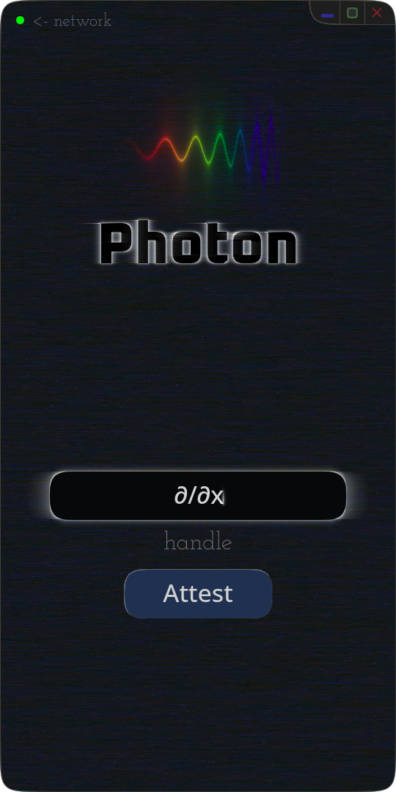

# Photon



**A messenger where your identity is yours — not a row in someone's database.**

No servers holding your account. No passwords to steal. No phone numbers, no SIM, no carrier. No company that can lock you out, hand you over, or shut you down.

---

## The idea in one breath

In every system you use today, someone else owns your identity. The bank, the platform, the carrier, the "sign in with…" button — each of them holds the key that actually *is* you, and you hold a contract that lets you ask them to act on your behalf. A contract can be revoked, subpoenaed, sold, or breached. In cryptography, whoever holds the private key **is** the owner; everyone else is a tenant.

Photon gives you the key.

Your identity is a **handle** you choose — any text at all: `purple octopus`, `∫∂x`, `ℕƐρ⊤∪ηǝ`, `slow tide`. From that handle, and from a secret burned into each of your devices, your identity is derived by math. No authority issues it. No authority can withdraw it. A service either can verify you or it can't — there's no account for anyone to freeze.

This buys you three things:

- **One identity.** Chosen once, for life. It works on every device, every network, everywhere — no re-registration, ever.
- **One action to move.** Pick up a new device, confirm once, and your whole world is there — every conversation, every contact, immediately. No re-login, no per-app setup.
- **No one in the middle.** No password to phish, no SIM to swap, no support line to social-engineer, no central store to breach. There is simply nothing of yours sitting in someone else's vault to take.

The full design — credential ownership, threshold recovery, billing you alone can authorize, physics-anchored time — is written up as the **TOKEN** patent family (part of a stack with **PIPE** hardware, **ISOMEM** memory isolation, and **SPIRIX** deterministic arithmetic). Photon is the messenger built on it: the first working piece.

---

## Read this before you start — four things that matter

Photon hands you real ownership, and ownership means the responsibility comes with it. Four things are worth understanding up front. None is hard; all four save you grief.

### 1. Choose your handle with care

Your handle **is** your identity — the root everything else grows from. It's the thing you hand to people out of band (say it out loud, write it on paper) so they can reach you.

- **It is not a username and not your name.** Don't use your legal name or an email address. A handle like `paper kite` or `slow tide` is distinctive, memorable, and doesn't collide with everyone who shares your first name.
- **Anything routes.** Because the network only ever sees a *hash* of your handle, the handle itself can be any Unicode at all — spaces, emoji, math, any script. `omega cyan` and `omega_cyan` are entirely different handles, so use the real space you'd actually say.
- **Case and spacing matter.** `omega cyan`, `Omega cyan`, and `Omega Cyan` are three different identities. Lowercase with real spaces is easiest to dictate.
- **First to claim it, owns it.** Claiming is deliberately cheap once and expensive in bulk (a ~1-second proof-of-work rations it), so squatting a namespace is uneconomic — but if two people pick the same handle, the first to finish claiming keeps it. Pick something distinctive.
- **Disclosing your handle is safe.** Unlike a password, you *can* hand your handle to people. Knowing it lets no one act as you and — because reaching you requires *both* sides to add each other — it doesn't even let someone contact you unless you add them back. There's no directory and no unilateral "just message this handle." Contact is always two-sided and consented.

Your handle names you; it never authorizes anyone. Acting as you additionally requires one of *your* devices. That's what the next three points are about.

### 2. Never be down to your last device — and don't lose it

Your identity lives across the devices you've added to it. Any one of them is fully you; losing one is losing *a device*, not your identity — the others carry on untouched, and you revoke the lost one remotely.

The danger is being down to **one** device and losing *it*. Today, if that last device is gone and you haven't set up recovery, your identity is gone with it — there's no company to call, which is the whole point, but it also means **there's no company to call.** So:

- **Add a second device the day you start** (next point). Two is the floor; more is better.
- **Recovery thru people is coming** (point 4) — trusted friends who can vouch you back onto a fresh device after *total* loss. Until that's fully wired, treat your devices as the only copies of your identity, because they are.

A wiped device (factory reset, reinstall) is a special case: it keeps the one secret that proves it's yours, so it can rejoin your fleet without recovery. This also prevents an attacker from using your device without your consent.

### 3. Add several devices — it's one tap

Adding a device is a single deliberate act, and it needs no carrier, no store, no account, no cloud:

- **In person:** hold an existing device near the new one and confirm on the old one. Done.
- **Apart:** the new device shows a short pairing phrase; type it into a device you already own, which signs the newcomer into your fleet.

The moment it's in, the new device *is* you — every conversation and contact already present, nothing to re-enter. One identity can be live on your watch, phone, laptop, and car at once; each device speaks as you, and you can revoke any of them from any other.

Spread across a few devices, you're resilient by default: lose one, you've lost nothing that matters.

*(Coming: an NFC tap to add a device — hold them together, tap, and the same ceremony runs underneath, the tap carrying only a public key. Physical invite cards that carry a handle are on the same track.)*

### 4. Recovery is people, not passwords

When recovery lands, this is how a *total* loss (every device gone) comes back: you choose a handful of trusted people — **custodians** — ahead of time. To come back you re-enter your handle on a new device, and a threshold of them recognize you (your face, your voice, a shared history) and each approve. No company, no reset link, no security questions.

The design requires **at least three** custodians and a threshold of at least three, so no single person — and no pair — can ever reconstitute you against your will, and you pick more than the threshold so ordinary life (a friend loses *their* phone, moves, drifts) never locks you out. Choose people who know you and whom you'd trust with this. Set them up early.

> **Status:** device fleet (add/remove/rejoin) and encrypted messaging are working today. Full people-based recovery is designed and in progress — see [What Works](#current-status) below. Until it's complete, **your devices are your only backup.** Add more than one.

---

## What This Is, precisely

Photon is a peer-to-peer messenger. Your identity is a handle you own, derived from your own entropy and never issued by anyone. Messages use **rolling-chain encryption** — each message cryptographically depends on the last, so the history is tamper-evident and forward-secret. There are no message servers: peers find each other thru a distributed hash table and then talk directly.

**Key properties:**
- **Authenticate once.** You prove who you are a single time, when you create your identity. Everything after is *verification* — cheap, repeated confirmation that a signature came from the same key — not a fresh login. There's no session to expire and re-establish.
- **You hold the key.** Your private credential never leaves your devices in any form that can be read, copied, or exported. Services hold only your public key, which is safe by definition. A breach of any service exposes nothing of yours.
- **Device-bound.** Acting as you requires one of your devices, whose secret is derived from a hardware identifier and never stored on disk. On commodity hardware that identifier is written by the OS vendor and, on desktop, readable by local code — so today this binds against *remote* attackers, not a true hardware secret. See [what this actually protects](#what-this-actually-protects-and-what-it-does-not-read-before-shipping-on-commodity-hardware). Dedicated **PIPE** silicon is the endgame that makes it a real hardware lock.
- **Contact is mutual.** No directory, no unilateral reachability. Two people can reach each other only after each adds the other — being contactable is itself a consented, two-sided relationship.
- **Recovery is human.** Lose everything and trusted people — not a company — vouch you back. (In progress.)

---

## Current Status

**🟢 Mainnet is live.** The network is open and permissionless — [install](#installation), pick a handle, and you're on. No invite, no waitlist, no approval. It's early and rough in places (see below), but it's real and running.

### What Works
- ✅ Cross-platform GUI (Windows, Linux, macOS, Android) on fluor, a direct-pixel renderer — no GPU pipeline
- ✅ Text input, selection, editing; every font bundled; sixteen languages, switched in-app
- ✅ Handle attestation with memory-hard proof-of-work (~1s computation)
- ✅ Peer discovery thru the FGTW phonebook (handle → device addresses), LAN discovery, NAT hole punching, port mapping, the fgtw.org relay as the last resort
- ✅ P2P status detection (online/offline via UDP ping/pong); presence broadcast off by default
- ✅ Deterministic device identity (keys derived from hardware, stored nowhere); on Android a Widevine plate that survives a factory wipe; the Fleet page shows each device's security level
- ✅ CLUTCH key exchange (8-algorithm parallel ceremony across four mathematical families, quantum-resistant by construction)
- ✅ Rolling-chain encryption (forward-secret, tamper-evident), re-keyed per era
- ✅ Encrypted P2P messaging over the chain, verified device-to-device; history backfills from a friend's fleet after a wipe
- ✅ One conversation model at any size: a conversation with only you in it (an atom), a pair, or a group (a molecule) — invitations, members you never friended, group pictures, and the group's history from the moment you joined (docs/conversations.md, docs/molecules.md)
- ✅ Multi-device fleet: add a device (near-tap or pairing phrase), remove/revoke, and rejoin after a wipe via the surviving device secret
- ✅ Fleet sync: contacts, settings, conversations and files converge across your devices under the fleet key; compose on any device
- ✅ Avatars (AV1 in VSF), sealed so only friends can open them; contact storage (local encrypted + cloud backup to FGTW)
- ✅ Waves: end-to-end encrypted voice, direct peer to peer, single-digit-millisecond round trips on a LAN, lossless PCM on a clean path and an Opus ladder elsewhere; lost windows filled from the other side's recording; every wave kept as a per-party archive with a waveform card, replayable on its own screen, exportable as WAV or VSF
- ✅ Group waves at any size: join late, leave and come back; the third person and everyone after joins muted (docs/group-waves.md)
- ✅ Beams (video): H.264 over the wave's own encrypted path, HDR where the screen allows it, per-camera settings on the Beam page; saving a beam's video beside its audio is opt-in (docs/beams.md)
- ✅ Traffic rank: while a wave or beam is live, chat rows go first and bulk transfers are squeezed to a sixteenth of every path's window
- ✅ Files: any type, byte-exact, chunked and resumable, content-addressed and deduplicated; pictures, code and PDFs previewed in the row; images colour-managed thru opsin; every device of the fleet fetches a copy, one source at a time, on Wi-Fi only for phones
- ✅ The bridge: work one of your devices from another — a persistent shell with streamed output and Stop, and files dropped straight into the host's working directory, repaired and resumed across a restart — passless, because being in your fleet is the credential; each host switches its shell on by hand, off by default (docs/bridge.md)
- ✅ Self-update: signed release manifests, verified before exec; the desktop hot-swaps and re-execs, Android installs from its background service when the release posts; an update never lands in the middle of a wave; release notes shown in the app
- ✅ Notifications on every platform, opening their conversation when tapped and cleared fleet-wide once read anywhere; a doorbell to reach a friend whose devices are asleep
- ✅ Dozenal by default, hexadecimal for coders, arabic if you insist — every number on screen thru one base switch, magnitudes on a doubling scale (docs/dozenal.md)
- ✅ Ideas and bug reports from inside the app (Settings → Ideas), public to everyone (docs/ideas.md)
- ✅ Signed binary distribution with self-verification; Linux, Windows, macOS (Intel + ARM) and Android built from one deploy

### What Doesn't Work Yet
- ⚠️ Custodian recovery (all-devices-lost): threshold reconstruction is designed and partially built — **not yet a backstop you can rely on.** Keep more than one device.
- ⚠️ Group invitations are held by the person who sent them; an invitation that outlives its sender's devices is designed, not built
- ⚠️ NFC invite cards (designed; near-tap and typing are the paths today)
- ⚠️ The wider TOKEN surface — billing you alone authorize, portable reputation, physics-anchored time — is specified in the patent and not yet in Photon
- ⚠️ Waves and beams have no relay carriage: two phones that cannot reach each other directly (both behind carrier NAT) signal fine but carry no audio or video yet
- ⚠️ Off-grid Wi-Fi Direct (Android to Android, no infrastructure) is built and not yet field-proven (docs/offgrid.md)
- ⚠️ Retention: every device keeps everything; per-device horizons and eviction are designed, not built (docs/retention.md)
- ⚠️ The bridge hosts only on Linux and macOS, sends files one way only (into the host), and has no screen, sensor or interactive-terminal support yet — designed in docs/bridge.md
- ⚠️ TPM plates on the desktop: read and logged on Linux, nothing derives from them yet

### Platform Support

| Platform | Status | Notes |
|----------|--------|-------|
| Linux x86_64 | ✅ Working | fluor direct-pixel renderer, X11/Wayland |
| Linux ARM64 | ✅ Working | fluor direct-pixel renderer (Asahi etc.) |
| Windows | ✅ Working | GDI blit |
| macOS x86_64 | ✅ Working | fluor direct-pixel renderer |
| macOS Apple Silicon | ✅ Working | fluor direct-pixel renderer |
| Android | ✅ Working | ARM64, tested on device; automatic updates |
| iOS | ❌ Blocked | See "Why No iOS?" below |
| ferros | ⚠️ Builds | runs as a ferros process; the identity is the OS's |

---

## Installation

The one-line installer downloads a pre-built, cryptographically signed binary and creates shortcuts.
These commands mirror the ones on [holdmyoscilloscope.com/photon](https://holdmyoscilloscope.com/photon) exactly; [passless.org/photon](https://passless.org/photon) serves the same release.
The release installers check the download's SHA-256 against the release before running it.
If that site is ever down, use the **GitHub fallback** commands further down — they pull the identical signed binaries straight from this repo's Releases, so this page is a complete standalone install source.

### Release (Recommended)

**Linux/macOS:**
```bash
curl -sSfL https://brobdingnagian.holdmyoscilloscope.com/photon/install-release.sh | sh
```

**Windows (PowerShell):**
```powershell
powershell -ExecutionPolicy Bypass -c "irm https://brobdingnagian.holdmyoscilloscope.com/photon/install-release.ps1 | iex"
```

**Android:** [Download APK](https://github.com/nickspiker/photon/releases/latest/download/photon-messenger-android-release.apk) — enable "Install unknown apps" in Settings if prompted.
If Google Play Protect blocks an automatic update, Photon posts a notification; tap it to install the downloaded update by hand.

### Development

Pre-release builds for testing, visually tagged so they're never mistaken for release.

**Linux/macOS:**
```bash
curl -sSfL https://brobdingnagian.holdmyoscilloscope.com/photon/install-development.sh | sh
```

**Windows (PowerShell):**
```powershell
powershell -ExecutionPolicy Bypass -c "irm https://brobdingnagian.holdmyoscilloscope.com/photon/install-development.ps1 | iex"
```

**Android:** [Download APK](https://brobdingnagian.holdmyoscilloscope.com/photon/photon-messenger-android-development.apk)

After install, find **Photon Messenger** in your program list (Start Menu on Windows, app launcher on Linux), or run `photon-messenger` from a terminal.

### GitHub fallback (if holdmyoscilloscope.com is down)

The same signed binaries are mirrored to this repo's [Releases](https://github.com/nickspiker/photon/releases).
Every binary self-verifies its Ed25519 signature on launch regardless of where it was downloaded, so a GitHub-served binary is exactly as trustworthy as one from the primary site.

**Release** binaries live on the immutable `v<n>` tag — grab the [latest release](https://github.com/nickspiker/photon/releases/latest) and download the asset for your platform:

| Platform | Processor | Asset |
|----------|-----------|-------|
| Linux | x86_64 | `photon-messenger-linux-x86_64-release` |
| Linux | ARM64 (aarch64) | `photon-messenger-linux-arm64-release` |
| Windows | x86_64 | `photon-messenger-windows-release.exe` |
| Windows | ARM64 (aarch64) | `photon-messenger-windows-arm64-release.exe` |
| macOS | x86_64 | `photon-messenger-macos-x86_64-release` |
| macOS | ARM64 (aarch64) | `photon-messenger-macos-arm64-release` |
| Android | ARM64 (aarch64) | `photon-messenger-android-release.apk` |

Then mark it executable and run it (it verifies itself on first launch):
```bash
# Linux x86_64 example — swap the asset name for your platform
curl -sSfL -o photon-messenger \
  "$(curl -sSfL https://api.github.com/repos/nickspiker/photon/releases/latest \
     | jq -r '.assets[] | select(.name=="photon-messenger-linux-x86_64-release") | .browser_download_url')"
chmod +x photon-messenger
./photon-messenger
```

**Development** binaries are content-addressed (`...-development-<hash>`) on the rolling [`dev`](https://github.com/nickspiker/photon/releases/tag/dev) prerelease, so every build has a fresh URL that can never be served stale. Resolve the newest one for your platform via the API, using the base name for your platform:

| Platform | Processor | Base name |
|----------|-----------|-----------|
| Linux | x86_64 | `photon-messenger-linux-x86_64-development` |
| Linux | ARM64 (aarch64) | `photon-messenger-linux-arm64-development` |
| Windows | x86_64 | `photon-messenger-windows-development.exe` |
| Windows | ARM64 (aarch64) | `photon-messenger-windows-arm64-development.exe` |
| macOS | x86_64 | `photon-messenger-macos-x86_64-development` |
| macOS | ARM64 (aarch64) | `photon-messenger-macos-arm64-development` |
| Android | ARM64 (aarch64) | `photon-messenger-android-development.apk` |

```bash
# Set base to your platform's base name from the table above (this example: Linux x86_64)
base="photon-messenger-linux-x86_64-development"
url=$(curl -sSfL https://api.github.com/repos/nickspiker/photon/releases/tags/dev \
      | jq -r "[.assets[] | select(.name | startswith(\"$base-\"))] | sort_by(.created_at) | reverse | .[0].browser_download_url")
curl -sSfL -o photon-messenger "$url"
chmod +x photon-messenger
./photon-messenger
```

**Security**: every binary is Ed25519-signed by Nick Spiker (fractaldecoder@proton.me) and self-verifies on startup. This protects against corruption and tampering; if verification fails, the binary won't run.

### Building from Source

You need **git**, **Rust** (from [rustup.rs](https://rustup.rs)), **CMake** and a C toolchain; on Linux also the usual X11/Wayland/ALSA development headers ([scripts/provision-builder.sh](scripts/provision-builder.sh) has the exact package lists).
The Opus voice codec is compiled from vendored source into the binary, so there is no libopus to install.

```bash
mkdir Code && cd Code
git clone https://github.com/nickspiker/photon
cd photon
./build.sh
```

That's all. Photon builds against a family of sibling crates (vsf, fluor, fgtw and others), each its own repo; `build.sh` clones whichever are missing beside `photon/`, builds the development profile and runs it.
The list of siblings comes from the Cargo.toml files themselves, so it is never out of date.

- `./build.sh --no-run` builds without launching; the binary is `target/debug/photon-messenger`.
- `scripts/pull-deps.sh` brings photon and every sibling up to date together (a fresh photon against a stale sibling fails with errors that look like photon's fault).
- Working on a fork of the siblings too? `PHOTON_SIBLINGS_BASE=https://github.com/<you> ./build.sh` clones them from there.
- `cargo test` runs the test suite.

A development build is **unsigned**, and that's fine: release binaries check their own Ed25519 signature at startup, and a development build without one skips that check.
Building a signed release needs signing keys of your own (see [src/bin/photon-keygen.rs](src/bin/photon-keygen.rs) and [src/crypto/self_verify.rs](src/crypto/self_verify.rs)).

**Android** needs the Android SDK and NDK, JDK 17 or 21, and an APK signing keystore; the scripts in `scripts/android/` expect the maintainer's keystore today, so building your own APK means pointing `scripts/lib/keystore.sh` at yours.

**The maintainer's scripts** live in `scripts/release/`: the release (`deploy.sh`), the dev-channel publishes, and the signed local builds.
They need the project's signing keys and hosting credentials, so you won't run them; they are there so you can see exactly how the published binaries are made.

---

## How It Works

### Device Identity (Keys Derived From Hardware)

Photon derives device keys **deterministically from hardware identifiers**—keys are never stored on disk. Each launch, the app reads a platform-specific machine fingerprint and derives the Ed25519 keypair:

```rust
let fingerprint = get_machine_fingerprint();  // Platform-specific
let seed = blake3::hash(&fingerprint);        // 32-byte seed
let keypair = Ed25519::from_seed(&seed);      // Deterministic
```

**Platform fingerprint sources:**

| Platform | Source | Stability |
|----------|--------|-----------|
| Linux | `/etc/machine-id` | Survives reboots, unique per install |
| Windows | Registry `MachineGuid` | Survives reboots, unique per install |
| macOS | `IOPlatformUUID` | Hardware-burned, survives reinstalls |
| Android | Widevine `deviceUniqueId` ‖ APK signing certificate ‖ `ANDROID_ID` | Key: per-device, per-signing-key, rotates on a factory wipe. Plate `BLAKE3(deviceUniqueId ‖ certificate)`: hardware-burned, survives the wipe |

**Why derived keys?**

Stored keys can be copied to another device (identity theft), extracted by malware, or found in forensic analysis. Derived keys tie identity to physical hardware—the device IS the identity.

#### Hardware Security Reality

Modern devices contain dedicated security chips capable of unforgeable cryptographic proofs:

- **Android**: StrongBox/TEE secure processors
- **iOS/macOS**: Secure Enclave (T2/Apple Silicon)
- **Windows/Linux**: TPM 2.0

These chips can perform **cryptographic oracles**—signing data with hardware-bound keys that never leave the chip. This would provide stronger guarantees: attacker can't forge signatures without physical chip access, software compromise doesn't leak secrets, device identity persists across OS reinstalls.

**Why Photon doesn't use hardware security:**

Platform vendors reserve these features for internal services and don't expose them to third-party applications:

| Platform | Hardware | Third-Party Access | Limitation |
|----------|----------|-------------------|------------|
| Android | ✅ StrongBox/TEE | ✅ Partial | The Widevine device ID is a 256-bit factory-burned value read locally from the TEE, with no Google server in the loop; readable by every app, so not a secret |
| iOS/macOS | ✅ Secure Enclave | ❌ Internal only | Reserved for Apple services |
| Windows | ✅ TPM 2.0 | ⚠️ Complex | Inconsistent availability, no standard API |
| Linux | ✅ TPM 2.0 | ⚠️ Manual | Requires manual setup, arcane tools |

Android gives two halves and no single value with both properties. The Widevine device ID (`MediaDrm` `PROPERTY_DEVICE_UNIQUE_ID`) is burned in at manufacture, read on the phone with no DRM session and no provisioning round trip (verified in airplane mode), and byte-identical across a factory reset; but every app on the phone can read it. `ANDROID_ID` is effectively `HMAC(device_secret, signing_key)` with 64-bit output, scoped so another app cannot read it; but it rotates on a wipe. So the key folds both in, and the plate is the Widevine half alone. Other platforms provide readable identifiers (machine-id, IOPlatformUUID) that are unique and persistent but not cryptographically secret.

**Photon's approach:**

Given platform limitations, Photon derives app-specific secrets from readable identifiers:

```rust
const APP_CONTEXT: &[u8] = b"photon_device_identity_v0";
let device_secret = blake3::derive_key(APP_CONTEXT, &machine_id);
```

This provides device-*binding*: the key is tied to *this* install's identifier, so a purely **remote** attacker—one who never runs code on the box and never gets a copy of the identifier—cannot derive it. That is the entire security benefit, and it is worth stating precisely because it is narrow.

#### What this actually protects, and what it does not (read before shipping on commodity hardware)

Be honest about the primitive: `derive_key(context, machine_id)` has **nothing secret on the right-hand side.** `context` is a constant in this open-source code; `machine_id` is a value the OS vendor writes and, on every desktop platform, exposes to unprivileged local code:

| Platform | Identifier | Who can read it |
|----------|-----------|-----------------|
| Linux | `/etc/machine-id` | **World-readable (`0444`)**—any local process, no root |
| Windows | `HKLM\...\Cryptography\MachineGuid` | Any user—`HKLM` read is not privileged |
| macOS | `IOPlatformUUID` | Any user via `ioreg`—no root |
| Android | Widevine ID ‖ certificate ‖ `ANDROID_ID` | The Widevine ID and the certificate: **any app**. The `ANDROID_ID` half: **needs root** (or your signing key)—app-scoped, so another app can't complete the key without privilege; but only 64-bit |

Android is the outlier, and debatably the only one that clears the bar: the key folds in an app-scoped identifier, so completing it takes root or your app-signing key—a real OS boundary, not just obscurity (its weakness is the 64-bit width of that half, not the access model). The price is that the key rotates with a factory wipe, so a wiped phone pairs again from a sibling; what survives the wipe is the plate, the Widevine half alone, which names the phone to the fleet and the phonebook so a wiped phone that comes back under a new key is still recognised as the same phone (and a plate reported stolen can be refused). The desktop three have **no** such boundary. So on a desktop the honest threat model is: **any code that runs on the machine—no root required—can read the identifier, recompute the device key, and clone the device's identity.** "Keys are never stored on disk" is true and beside the point; not storing the key buys nothing when its only input is a world-readable file and the derivation is public. This is device-binding by *derivation*, not a secret held in hardware. It is **not** comparable to an SSH key or a wallet seed (those are `0600` secrets the owner controls); the primary threat is not physical theft but ordinary local code.

Two consequences fall out, and neither is Photon's to fix in software:

- **Secrecy is the OS vendor's, not Photon's.** Google/Apple/Microsoft/your distro decide who can read that identifier. Photon does not ship a lock here—it reads an identifier someone else defined and hopes it is both unique *and* confined. On today's desktops it is neither. The realistic protection is "remote attackers only," which is real but far short of "the device is the identity."
- **Uniqueness is also the vendor's.** Even where the identifier *is* access-confined, Photon still depends on the vendor's promise that it is **unique**. A duplicated identifier—golden-image cloning, a botched provisioning step, a bad OTA—makes two physical devices derive the **same** key; to the fleet chain they are one device, each able to silently attest into the other's fleet. The **fault** is the vendor's; the **loss** is the user's. Photon's derivation converts a duplicated ID from a privacy nuisance into an identity collision.

**If you fork or ship Photon on commodity hardware,** treat both properties as assumptions to *verify with your device manufacturer in writing*, as security requirements: can the identifier be read by other local code, and can it ever collide or survive-and-duplicate thru the update pipeline? On stock desktop Linux/Windows/macOS the first answer is already "yes, any local code can read it," so size your threat model accordingly.

**The only actual fix is PIPE.** A per-die physically-unclonable identity has no software-visible value to read *or* duplicate: the secret is silicon manufacturing variance, never in a file, never in a register the OS can hand out. That collapses both failures at once—local-read and cross-device-collision become physically impossible rather than merely against-policy, and the residual trust shrinks to one auditable fab provisioning step instead of "every OS vendor's ID hygiene, forever." Photon does not write your device ID today—Google, Apple, Microsoft, and your distro do, and on desktop they hand it to anyone who asks. PIPE is the lock Photon would actually ship; it is silicon that isn't taped out yet. Until it is, everything above is device-binding-by-derivation wearing this label, honestly.

The hardware to do better already exists (StrongBox, Secure Enclave, TPM 2.0) and platform vendors use it internally for attestation, DRM, and payments. Third-party access is a business-model conflict, not a technical limit—which is exactly why the durable answer is silicon Photon's stack controls rather than an API a vendor rations.

---

### Rolling-Chain Encryption

Traditional messaging (Signal, WhatsApp) uses **Double Ratchet**: sender advances keys immediately, receiver stores "skipped message keys" for out-of-order delivery. This enables asynchronous messaging but makes ordering non-deterministic.

Photon uses **rolling-chain encryption**: the sender does not advance chain state until receiving confirmation that the message was successfully received and decrypted. This creates a synchronization loop:

```
Alice (state₀)  ──message encrypted with state₀──→  Bob (state₀)
                                                      Bob decrypts, advances to state₁
Alice (state₀)  ←──────ACK or reply──────────────  Bob (state₁)
Alice advances to state₁
[Both now at state₁, loop complete]
```

**Properties enabled by acknowledgment-based advancement:**

0. **Prevents desynchronization**: Lost messages leave both parties at same state—no "skipped keys"
1. **Enforces ordering**: Messages processed sequentially with verified sequence numbers
2. **Enables immutability**: Deleting or editing message breaks all subsequent hashes—cryptographic proof of tampering
3. **Simplifies recovery**: New devices replay message history from checkpoints without complex key management

**How the chain works:**

Each participant has a 512-link chain (16KB): 256 active links derived from the CLUTCH shared secrets, and 256 links of history that fill as the chain advances. The current key is the newest link, at the right-hand end:

```rust
/// 512-link chain (16KB) - one per participant (src/crypto/chain.rs)
pub struct Chain {
    links: [[u8; 32]; 512], // [0..256) history, [256..512) active, [511] = current key
}

impl Chain {
    /// Advance after ACK: shift every link left (the oldest history drops off), derive the new key at [511]
    pub fn advance(&mut self, eagle_time: &EagleTime, our_plaintext: &[u8], their_plaintexts: &[&[u8]]) {
        self.links.copy_within(1..512, 0);
        // spaghettify (ihi) over the time, this message, the peer messages it braids in, and the whole chain
        self.links[511] = derive_fresh_link(eagle_time, our_plaintext, their_plaintexts, &self.links);
    }
}
```

**The braid.** Each step weaves in the other participants' prior messages, so the chains cross-depend rather than ratcheting one way each (docs/braid.md). **Why this size?** 16KB sits in L1 cache, the history window gives a recovery span, and every advance runs the whole chain thru the derivation. Each participant only advances their own chain—no race conditions in N-party conversations.

Breaking one message doesn't reveal others (forward secrecy via BLAKE3 preimage resistance). Modifying message `i` changes all subsequent states—tampering is cryptographically detectable.

**Encryption layer:**

The chain state XOR is not the only encryption. The braid's message layer is **XChaCha20** (the 192-bit-nonce variant), and the at-rest + control planes (vault, capsules, avatars, fleet-key wraps, wave media) all use **XChaCha20-Poly1305 AEAD**:

```rust
encryption_key = BLAKE3_KDF(chain_state, "photon.chain.xchacha.v1")
encrypted_message = XChaCha20::apply_keystream(key, xnonce_24, plaintext)  // braid Layer 2
sealed_at_rest    = XChaCha20Poly1305::encrypt(key, xnonce_24, plaintext)  // vault / blobs / etc.
```
Rolling-chain provides immutability and ordering; XChaCha20-Poly1305 provides standard cryptographic security. The 192-bit (24-byte) nonce — migrated from ChaCha20's 96-bit nonce in 2026-08 — removes the birthday bound on random nonces entirely; the legacy 12-byte-nonce readers are gone.

**Latency characteristics:**

This synchronization model doesn't compromise performance. Direct peer-to-peer connections have significantly lower latency than server-relayed messaging:

| Path | Round-trip Latency |
|------|-------------------|
| Photon wave, same LAN (measured 2026-09-12) | 5-10ms |
| Photon wave, same city over IPv6 (measured 2026-09-12) | ~10ms |
| Photon wave, cellular to home wifi (measured 2026-09-12) | ~55ms |
| Photon P2P (Seattle–Los Angeles) | ~25-30ms |
| Photon P2P (Los Angeles–New York) | ~50-60ms |
| Signal/WhatsApp | 100-300ms (server relay) |
| Zoom | 100-300ms (central server) |
| FaceTime | 80-200ms (Apple relay) |

For regional connections (Seattle–LA), video frames arrive **before the next frame starts capturing** at 30fps (33.33ms per frame). Acknowledgments return faster than human perception can register. Even coast-to-coast (LA–NYC), Photon is **3-6x faster** than commercial services while providing cryptographic immutability and no corporate surveillance.

**Trade-offs:**

| Double Ratchet (Signal) | Rolling-Chain (Photon) |
|------------------------|------------------------|
| Async: sender advances immediately | Sync: sender waits for ACK |
| Out-of-order delivery supported | Sequential processing enforced |
| Skipped message keys stored | No skipped keys |
| Message deletion undetectable | Deletion breaks chain (detectable) |
| Message editing undetectable | Editing breaks chain (detectable) |

---

### Passless Identity

**You authenticate once — when you create your identity.** Everything after is verification: a cheap, repeated check that a signature came from the same key. There is no password, no session that expires, no "prove you're you" loop. A service either holds your public key and recognizes you, or it doesn't.

Traditional login asks you to prove identity and then accepts a *password* — which proves only knowledge of a secret, not who you are, and not even that you're human. Reset flows are worse: whoever reaches your email or phone can take the account. Photon replaces the whole model with the one humans have always used — **the key is yours, and trusted people vouch for you** — so there's no company, no support line, and no "click to reset."

**How your handle becomes an identity.** Your handle is hashed to a routing address (the handle itself never travels the network — that's why any Unicode works). Claiming an unclaimed handle costs a ~1-second memory-hard proof-of-work: trivial to do once, expensive to do in bulk, which prices out namespace-squatting without any authority deciding who's allowed a name. First to finish claiming owns it. See [choosing your handle](#1-choose-your-handle-with-care) above and [docs/lifecycle.md](docs/lifecycle.md) for the identity's whole life.

**Existence now, standing later.** Claiming a handle makes you *real* on the network immediately — that's permissionless and always will be. But being a *trusted, weighted* identity is a separate thing that's **earned, not granted**, and it comes later. Every handle starts at zero standing and accrues reputation only thru attested interactions with others who already carry standing — a structure the design calls the **Fractal Gradient Trust Web**. A vouch phase is on the roadmap for that: existing identities vouching for others, reputation flowing along real relationships. It can't come first, because there has to *be* a web of genuine relationships to vouch within — and that's exactly what messaging is bootstrapping right now. So today: message people, build the web. The standing layer grows on top of it.

> **On vouching and gates:** any vouch phase governs *standing within a context* — how much weight your word carries, what a community will admit — never whether a handle may **exist**. The base namespace is permissionless forever. The power to deny existence is the institutional-capture failure Photon is built to eliminate, so the sovereign namespace holds no such power for anyone to seize or be compelled at.

**Getting onto more devices, and getting back after loss** — the two paths, covered above:

- **Add a device** (you still hold one): near-tap in person, or type a short pairing phrase across a gap. The newcomer is signed into your fleet and is immediately, fully you. → [Add several devices](#3-add-several-devices--its-one-tap)
- **Recover** (everything lost): trusted custodians recognize you and vouch you back onto a fresh device. No company in the loop. → [Recovery is people](#4-recovery-is-people-not-passwords) *(in progress)*

---

### Network Architecture

**Peer discovery:** FGTW (Fractal Gradient Trust Web). Today the phonebook is served by `fgtw.org`, a Cloudflare Worker: a handle proof looks up the signed fleet chain and the device addresses behind it, and a WebSocket from the seed pushes peer updates. Devices on one LAN find each other directly. Retiring the server in favour of the peers themselves, gossip first and a full DHT later, is designed in [docs/peers-are-fgtw.md](docs/peers-are-fgtw.md).

**Transport:** everything on the wire is a complete VSF file. Small frames ride UDP; anything larger goes thru PT, Photon Transport ([docs/PT.md](docs/PT.md)): reliable lettered streams over UDP with ACKs, retransmits and per-path pacing, falling back to TCP. Paths are found by NAT hole punching and port mapping, each device publishing its v4 and v6 addresses apart ([docs/addresses.md](docs/addresses.md)); the `fgtw.org` relay carries frames between two devices that cannot reach each other at all. While a wave or beam is live, the rank puts its media first, then control frames and chat rows, and squeezes bulk transfers.

**Message routing:**
- Direct UDP or PT when both peers are online
- A doorbell to wake a friend whose devices are asleep ([docs/reachability-doorbell.md](docs/reachability-doorbell.md))
- After a wipe or on a new device, history backfills from your own fleet and from your friends' devices

**Storage model:** Messages persist as long as you want them to, on the devices you control; your fleet holds every copy, and a friend's fleet holds the conversations you share with them. `fgtw.org` holds the phonebook, sealed backups and avatars it cannot open, never a message. The relay of last resort sees only sealed frames between device keys.

---

## Architecture

### Module Structure

[src/lib.rs](src/lib.rs) opens with the full, maintained map of the source tree. The top level:

```
src/
├── main.rs        - Process entry, window and event loop
├── lib.rs         - Module exports and the source map
├── crypto/        - The braid (chain.rs), CLUTCH, eras, handle proofs, binary self-verification
├── network/       - Status and ceremonies (status.rs), PT, NAT traversal, the FGTW client and fleet chain,
│                    the rank, doorbell, updates, history pages, Wi-Fi Direct
├── wave/          - Waves and beams: engines, media keys, recording and replay, H.264, the beam session
├── storage/       - The vault's entries: contacts, friendships, molecules, fleet settings, spools
├── types/         - Contacts, conversations, molecules, rows and their typed controls
├── ui/            - The app (photon_app/), layouts, avatars, fonts, sixteen languages, renderers
├── platform/      - Per-OS glue: Android JNI, audio, cameras, notifications, the tray
└── bin/           - photon-keygen, photonlog and other tools
```

### Implementation Status

| Component | Status | Notes |
|-----------|--------|-------|
| UI Framework | ✅ Complete | fluor: direct pixel access, damage-band repaints, scroll as a memmove |
| Text Rendering | ✅ Complete | fluor text shaping, bundled fonts, selection, editing |
| Device Identity | ✅ Complete | Deterministic keys from hardware (never stored) |
| Crypto Types | ✅ Complete | Identity, seed, shard, message structures |
| CLUTCH Key Exchange | ✅ Working | 8-algorithm ceremony, deterministic ceremony_id, re-keyed per era |
| Friendship Chains | ✅ Working | Per-device lanes, braid v2, CRDT merge across the fleet |
| Handle Attestation | ✅ Working | Memory-hard PoW (~1s), DHT storage |
| Peer Discovery | ✅ Working | FGTW DHT + LAN broadcast + port mapping + relay fallback |
| P2P Status | ✅ Working | UDP ping/pong with Ed25519 signatures, hysteresis |
| Avatar System | ✅ Working | VSF-encoded, FGTW storage, rate-limited uploads |
| Contact Storage | ✅ Working | Local encrypted + cloud backup to FGTW |
| Binary Signing | ✅ Working | Ed25519 signatures, self-verification on startup, self-update |
| Network Transport | ✅ Working | UDP + Photon Transport (lettered streams) for large payloads; TCP and relay fallbacks |
| Message Persistence | ✅ Working | manifestus VSF vault; content-addressed blobs for files and recordings |
| Peer Messaging | ✅ Working | Sealed photons over the chain, fleet-replicated, friend backfill after a wipe |
| Waves (voice) | ✅ Working | Direct, forward-error-corrected, recorded per party |
| Files | ✅ Working | Chunked, resumable, previewed, replicated fleet-wide |
| Bridge | ✅ Working | Unix hosts; remote shell + file drops over PT |
| Molecules (groups) | ✅ Working | One conversation model at any size; invitations, never-friended members, group pictures |
| Group waves | ✅ Working | Any size, join late, one stream per person |
| Beams (video) | ✅ Working | H.264, HDR where the screen allows, opt-in saved video |
| Social Recovery | ⚠️ Partial | Custodian recovery designed, not yet a reliable backstop |

### Technology Stack

**Core:**
- `fluor` - Direct-pixel renderer and text, drawn on the CPU into the window’s buffer; on macOS `wgpu` (Metal) only presents the finished frame
- `winit` + `softbuffer` - Windowing and the pixel buffer on the desktop (GDI on Windows)
- `arboard` - Clipboard access

**Media:**
- `rav1e` / `rav1d` - AV1, the only image encoding (avatars, group pictures)
- `opus` - Wave audio (vendored libopus); `raptorq` - fountain-coded loss repair
- `openh264` - Beam video on the desktop; the phones encode in MediaCodec
- `cpal` - Desktop audio

**Crypto:**
- `blake3` - Cryptographic hashing (chain state, KDF)
- `chacha20poly1305` - XChaCha20-Poly1305 AEAD (192-bit nonce); `chacha20` - XChaCha20 stream (braid Layer 2)
- `x25519-dalek`, `ed25519-dalek` - Elliptic curve key agreement and signatures; CLUTCH adds six more KEMs, device envelopes add Falcon
- `zeroize` - Secure memory wiping

**Network:**
- `tokio` - Async runtime
- `tokio-tungstenite` - The WebSocket from the seed that pushes peer updates
- `reqwest` - HTTP client with rustls (phonebook and blob fetches)

**Storage:**
- `vsf` - Versatile Storage Format (self-describing binary with embedded schemas, versioning, and per-record cryptographic signatures)
- `kete` - The encrypted device vault every entry lives in

---

## File Format: VSF (Versatile Storage Format)

Everything Photon stores or sends is VSF—a self-describing binary format with cryptographic integrity. Every frame on the wire and every entry in the vault is a complete VSF file: magic header, version, Eagle Time creation stamp and a provenance hash over the whole document.

**VSF provides:**
- Type-length-value encoding, every value carrying its own type marker
- Embedded schemas with version information
- Forward compatibility
- Per-record cryptographic signatures
- Huffman-compressed Unicode text, Eagle Time, integers of any width

The format and its tools (`vsfinfo` to inspect any VSF file, `vsflog` for Photon's sealed logs) live in [github.com/nickspiker/vsf](https://github.com/nickspiker/vsf).

---

## Distribution Philosophy

We do not distribute via Google Play Store, Apple App Store, or Microsoft Store. These platforms create barriers incompatible with our security model and decentralized architecture. Ready-to-run signed binaries are on [holdmyoscilloscope.com/photon](https://holdmyoscilloscope.com/photon), [passless.org/photon](https://passless.org/photon) and this repo's [Releases](https://github.com/nickspiker/photon/releases).

**Reasons for direct distribution:**

0. **Encryption reporting requirements**: US Export Administration Regulations require registration with the Bureau of Industry and Security and disclosure of encryption implementation details before international distribution.

1. **Review process uncertainty**: App stores can reject applications with strong encryption or demand explanations of security implementations.

2. **Corporate intermediaries**: Distribution thru stores requires trusting corporations to maintain access to software.

3. **Sideloading restrictions**: iOS requires annual re-signing ($99/year developer account), free accounts must reinstall every 7 days. Android allows direct APK installation but shows discouragement warnings, and Google Play Protect can block an update outright.

We provide cryptographically signed binaries with published checksums. Users verify signatures, verify source, and run directly.

---

## Why No iOS?

Apple's iOS platform has architectural incompatibilities with Photon's design:

**Distribution barriers:**
- App Store requires $99/year developer account tied to real identity
- All binaries must be Apple-signed
- Sideloading requires re-installation every 7 days (free accounts) or yearly (paid)
- Enterprise distribution violates terms if used publicly
- No mechanism for "public infrastructure without corporate owner"

**Technical limitations:**
- **No raw socket access**: Cannot connect to DHT peers directly
- **No background processes**: Apps terminated after ~30 seconds in background
- **Sandbox restrictions**: Cannot run persistent TOKEN daemon
- **Entitlement gatekeeping**: Network access requires Apple approval
- **No system-level services**: Architecture assumes apps are foreground-only

Photon requires persistent background connections, direct peer-to-peer networking, and system-level cryptographic services. iOS prohibits all of these by design, not by technical limitation.

The EU's Digital Markets Act may force sideloading in Europe by 2026, but likely won't address the fundamental architectural restrictions.

---

## Comparison with Existing Messengers

| Property | Signal | WhatsApp | Matrix | Photon |
|----------|--------|----------|--------|--------|
| Architecture | Centralized | Centralized | Federated | P2P |
| Authentication count | Multiple | Multiple | Multiple | **1** |
| Social recovery | No | No | No | **In progress** |
| Metadata privacy | Partial | No | Partial | **Mostly** |
| Self-sovereign data | No | No | Partial | **Yes** |
| Message immutability | No | No | No | **Yes** |
| Phone number required | Yes | Yes | No | No |
| Single point of failure | Yes | Yes | Partial | No |

**Architecture implications:**

- **Centralized** (Signal, WhatsApp): Single company runs servers. Can be subpoenaed, shut down, or pressured by governments.
- **Federated** (Matrix): Multiple servers run by different operators. Better than centralized but still relies on homeservers—messages flow thru infrastructure users don't control.
- **P2P** (Photon): No message servers. Peers connect directly. The phonebook at fgtw.org tells a device where your devices are; it never carries a message, and retiring it into the peers themselves is designed.

**Signal/WhatsApp:**
- Centralized servers (legal vulnerability)
- Phone number required (ties identity to carrier)
- No social recovery (lose device → lose account)
- Message deletion undetectable by recipient

**Matrix:**
- Federation, not P2P (homeserver dependency)
- Authentication per device/homeserver
- No social key recovery
- Metadata visible to homeserver operators
- Homeservers can be individually shut down

**Photon:**
- True P2P (no message servers)
- Single authentication event (A = 1)
- Social recovery (threshold reconstruction, in progress)
- Message immutability (tampering detectable)
- Metadata stays between devices: the phonebook sees lookups, the last-resort relay sees sealed frames between device keys, nothing sees a message

---

## Security Properties

**Guaranteed by rolling-chain encryption:**

0. Forward secrecy (compromising state_n doesn't reveal state_n-1)
1. Replay resistance (sequence numbers prevent replayed messages)
2. Reorder detection (out-of-order messages fail sequence validation)
3. Tamper evidence (modifying message breaks all subsequent hashes)
4. Message immutability (deletion/editing cryptographically detectable)

**Designed for the TOKEN attestation layer (not in Photon yet):**

0. Human identity verification (automated systems can't pass two attestations)
1. Rate limiting (1 attestation request per hour per device)
2. Collusion visibility (both attesters see each other's approval)
3. Reputation staking (attesters risk reputation vouching for abusers)

**Not protected against:**

- Physical device theft (if device unlocked)
- Threshold collusion (k or more trusted contacts)
- Screenshots or physical photography of screen
- Quantum attack, only in part: CLUTCH's keys hold while any one of its post-quantum KEMs does, and device envelopes carry Falcon beside Ed25519; anything agreed or signed by a curve alone would fall

---

## Design Philosophy

From [AGENT.md](https://github.com/nickspiker/photon/blob/main/AGENT.md):

0. **Trust the math**: If loop bounds guarantee safety, don't add runtime checks
1. **Fail fast, fail loud**: Panics expose bugs; bounds checks can hide them
2. **No fixed pixels**: Everything scales relative to screen dimensions
3. **Explicit over "safe"**: Direct indexing when mathematically proven safe

See [AGENT.md](AGENT.md) for complete code generation rules.

---

## Contributing

Contributions are welcome. Before writing code, read:

- [AGENT.md](AGENT.md) — the code rules, for people and coding agents alike: house formats only (VSF, AV1, Opus, H.264 for beams, BLAKE3, XChaCha20-Poly1305), no bounds check or clamp without a proof it is needed, Eagle Time only, no structured data smuggled through strings, C¹-smooth UI math. Changes that break them get sent back.
- [docs/](docs/) — one design document per subsystem. Good starting points: [conversations.md](docs/conversations.md) (one conversation model at any size), [braid.md](docs/braid.md) (the rolling-chain encryption), [clutch.md](docs/clutch.md) (the key ceremony), [waves.md](docs/waves.md) (voice) and [lexicon.md](docs/lexicon.md) (what Photon's words mean).
- [src/lib.rs](src/lib.rs) — opens with a map of the whole source tree.

Build with `./build.sh`; test with `cargo test` (the whole suite — `--lib` alone skips the tests in `tests/`).

Ideas and bug reports go thru **Settings → Ideas** inside Photon. Every one is public, so you can see whether yours is already in and what becomes of it.

---

## Related Projects

Photon is the first implementation of **TOKEN**—a universal digital identity system where authentication happens once (A = 1). Planned TOKEN applications:

- `ferros` - Kill-switch ready OS; Photon already builds for it as a ferros process, with the identity held by the OS
- Additional applications TBD

Once authenticated with TOKEN, all applications use that single identity. Install TOKEN on new device → everything appears automatically (apps, settings, messages, contacts, files). No passwords, no setup wizards, no per-app logins.

Photon demonstrates the social attestation and recovery model works before applying it to higher-stakes use cases (property deeds, medical records, financial assets).

---

## Terminology

- **handle** — your identity: any Unicode string, given to contacts out-of-band. `identity_seed = BLAKE3(x(handle))`, the hash of the handle's VSF `x` encoding (NFC is applied inside the encoder, the only transform anywhere), stays on the device; `handle_proof`, the memory-hard proof over that hash (*ihi*), is the public lookup key.
- ***ira*** — the device's permanent identity. Photon derives keys from it thru `tohu`; under PIPE it is silicon-rooted.
- **CLUTCH** — the key-generation ceremony that establishes a relationship.
- **CHAIN** — rolling per-message encryption over an established session.

### The units (wave-particle duality, taken literally)

- **photon** — a message: discrete, quantized, arrives whole. *"Shoot me a photon."* The unit is the noun and the verb takes care of itself: "photon me when you land."
- **wave** — voice: continuous, real-time. *"Wave me."* An inbound one is someone *waving*; a declined one is a wave that passes. The gesture and the physics mean the same thing, and neither of them is a phone call (docs/lexicon.md retires that word: a call is a circuit somebody else holds open, and a digital one is recorded by whoever carries it — a wave has no carrier and keeps its own recording, in the open).
- **beam** — video: a directed, continuous stream of light you can see by. *"Beam me."*
- **atom** and **molecule** — a conversation with only you in it, and one with others bound in. A pair and a group are the same model at different sizes.
- **detected** — a read receipt, consent-gated: a photon is not an observation until the detector fires, and the sender learns nothing until the receiver's detector does. Delivery states: *in flight*, *arrived*, *detected*.

Texts are particles, voice is waves. Photon: particles and waves.

Full cross-stack glossary: `GLOSSARY.md` in the ferros repo.

---

## License

MIT OR Apache-2.0 (dual-licensed)

See [LICENSE-MIT](LICENSE-MIT) and [LICENSE-APACHE](LICENSE-APACHE)

---

## Contact

**Nick Spiker** - fractaldecoder@proton.me

---

**Project Status:** 🟡 Early, on mainnet (messaging, groups, waves, beams and the fleet working; custodian recovery in progress)

**Platform Support:** Linux x86_64 ✅ | Linux ARM64 ✅ | Windows ✅ | macOS ✅ | Android ✅ | ferros ⚠️ | iOS ❌

**Last Updated:** 2026-11-05 (v143)